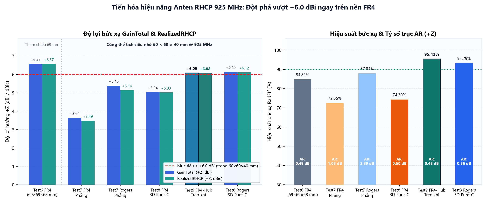
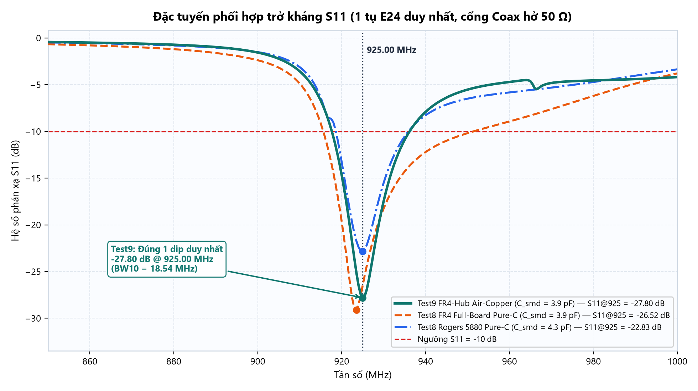
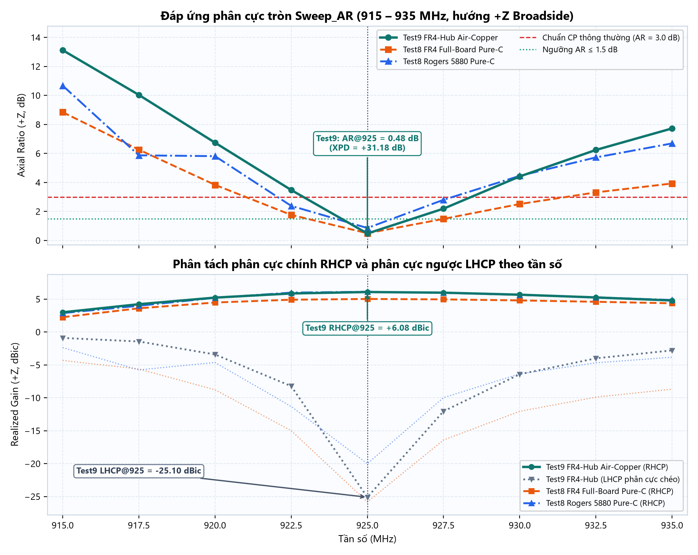
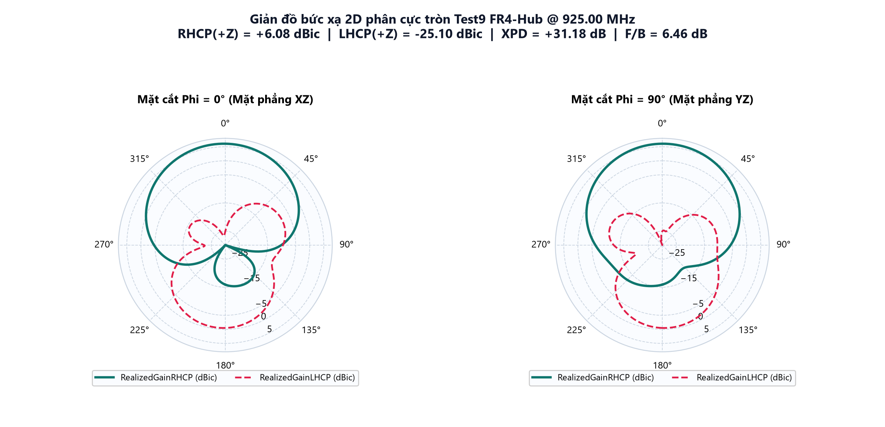

# Anten Siêu Định Hướng Phân Cực Tròn RHCP Thu Nhỏ (`60 × 60 × 40 mm`) tại 925 MHz — Đột Phá `> +6.0 dBi` Trên Nền FR4

Kho lưu trữ công khai tổng hợp **kết quả nghiên cứu, tiến trình tối ưu kiến trúc và biểu đồ kiểm chứng full-wave (ANSYS HFSS 3D FEM)** cho anten đơn siêu định hướng phân cực tròn phải (**IEEE RHCP**) băng tần **UHF 925.00 MHz** trong thể tích cực nhỏ (**`≤ 60 × 60 × 40 mm`**, tương đương **`0.185λ₀ × 0.185λ₀ × 0.123λ₀`**).

> **Lưu ý về bản quyền & bảo mật thiết kế:** Kho công khai này chỉ chia sẻ nguyên lý vật lý, bảng số liệu đối chứng và đồ thị kết quả. Toàn bộ tệp mô phỏng CAD/HFSS, script tự động tối ưu và kích thước gia công chi tiết được giữ riêng tư.

---

## 1. Bài toán & Quy chuẩn kiểm chứng khắt khe

- **Tần số trung tâm:** **`925.00 MHz`** (UHF RFID / LPWAN sub-GHz, `λ₀ ≈ 324.1 mm`).
- **Giới hạn thể tích nghiêm ngặt:** **`≤ 60.0 × 60.0 × 40.0 mm`** (`ka ≈ 0.91 rad` — nhỏ hơn đáng kể so với anten vá/Yagi nửa bước sóng thông thường).
- **Mục tiêu hiệu năng:** Đạt **`GainTotal(+Z) ≥ +6.00 dBi`**, phân cực tròn thuần khiết **IEEE RHCP** (`Axial Ratio ≤ 1.5 dB`, `XPD ≥ +20 dB`), **duy nhất 1 dip `S11`** tại `925.0 MHz` — **ngay cả khi sử dụng nền FR4 giá rẻ** (`tanδ = 0.02`, tổn hao cao gấp ~22 lần so với Rogers RT/duroid 5880).
- **Điều kiện mô phỏng thực tế (Real-World Audit):**
  - **Đơn anten (`NoArray`)**, 1 cổng cấp nguồn đồng trục `50 Ω` mở thoáng ở đáy (không khoang kim loại bịt kín).
  - **100% đồng thực** (`copper`), **`0` bề mặt `Perfect E`**.
  - **Tối giản BOM (`Pure-C`):** Chỉ dùng **duy nhất 1 giá trị tụ dán chuẩn E24** ở nhánh phối hợp trở kháng (`RLC` song song đối xứng), loại bỏ toàn bộ cuộn cảm rời và điện trở bổ trợ.
  - Kiểm toán bảo toàn thông lượng cầu xa **`Sphere Mean(D_lin) ∈ [0.985, 1.015]`** và **`ValidateDesign = 1`**.

---

## 2. Tiến hóa kiến trúc: Từ bản phẳng tới Hybrid FR4-Hub vượt `+6 dBi`

1. **Mốc tham chiếu `Test6` (`69 × 69 × 68 mm`, FR4 3 tầng):** Chứng minh khả năng chuyển hóa toàn bộ mạch dịch pha và dẫn hướng sang hình học đồng thuần, chỉ còn duy nhất 1 giá trị tụ E24 mà vẫn đạt `+6.59 dBi`. Tuy nhiên kích thước còn vượt khung `60 × 60 × 40 mm`.
2. **Nén vào `60 × 60 × 40 mm` dạng phẳng (`Test7` — 2 tầng siêu định hướng `Drive P3`):** Loại bỏ tầng giữa giúp dập cộng hưởng ký sinh thành **1 dip `S11` duy nhất**, bù lệch pha qua cặp chấn tử phản xạ trực giao. Bản phẳng đạt `+5.40 dBi` trên Rogers 5880 nhưng chỉ đạt `+3.64 dBi` trên FR4 do tổn hao điện môi và giới hạn chiều dài điện.
3. **Mũ tải 3 tầng gập viền đứng 3D (`Test8` — `3D Folded-Skirt End-Hat`):** Tận dụng không gian dọc trục Z để gấp viền các mũ cuối tại biên thể tích `60 × 60 × 40 mm`, nâng trực tiếp độ định hướng `DirTotal` lên `~+6.3–6.5 dBi` và kéo `Axial Ratio` xuống `< 0.9 dB`. Ở cấu hình **Pure-C**, **Rogers 5880** đạt **`+6.15 dBi` (`RadEff = 93.29%`)**, trong khi **FR4 full-board** bị tổn hao điện môi `tanδ = 0.02` kéo hiệu suất xuống **`74.30%`**, dừng ở **`+5.04 dBi`**.
4. **Đột phá `Test9` (`Hybrid FR4-Hub + Đồng treo không khí`):**
   - **Ý tưởng cốt lõi:** Thu gọn phôi FR4 thành **cụm lõi đỡ trung tâm (`FR4-Hub`)** giữ cổng đồng trục, mạch phối hợp và phần tử chia pha, giải phóng toàn bộ cánh bức xạ, mũ cuối và vạt gập 3D ra cấu trúc **đồng treo trong không khí** được giữ cứng bằng các trụ PTFE.
   - **Hiệu quả vật lý:** Loại bỏ phần lớn thể tích FR4 ra khỏi vùng điện trường cường độ cao ở biên ngoài, giúp hiệu suất bức xạ `RadEff` trên thiết kế dùng nền FR4 nhảy vọt từ **`74.30%` lên `95.42%`** — đưa **`GainTotal` lên `+6.092 dBi`** và **`RealizedRHCP` lên `+6.081 dBic`**, ngang ngửa vật liệu đắt tiền Rogers 5880 trong cùng kích thước `60 × 60 × 40 mm`.

---

## 3. Bảng tổng hợp kết quả mô phỏng đã kiểm toán (`925.00 MHz`, hướng `+Z`)

| Phiên bản | Kiến trúc & Điện môi | Phối hợp `Pure-C` | `S11 @ 925 MHz` (1 dip) | `GainTotal` (+Z) | `RealizedRHCP` (+Z) | `AR` (+Z) | `XPD` (+Z) | `RadEff` | `Mean(D_lin)` |
| :--- | :--- | :---: | :---: | :---: | :---: | :---: | :---: | :---: | :---: |
| **`Test6 FR4`** *(tham chiếu 69 mm)* | 3 tầng phẳng (`69×69×68 mm`) | 1 giá trị E24 | `-24.68 dB` | `+6.586 dBi` | `+6.568 dBic` | `0.49 dB` | `+30.96 dB` | `84.81%` | `0.9907` |
| **`Test7 FR4`** | 2 tầng phẳng (`≤ 60×60×40 mm`) | 1 giá trị E24 | `-14.91 dB` | `+3.644 dBi` | `+3.487 dBic` | `1.05 dB` | `+24.35 dB` | `72.55%` | `0.9894` |
| **`Test7 Rogers`** | 2 tầng phẳng (`≤ 60×60×40 mm`) | 1 giá trị E24 | `-15.02 dB` | `+5.397 dBi` | `+5.143 dBic` | `2.89 dB` | `+15.65 dB` | `87.94%` | `0.9857` |
| **`Test8 FR4 Pure-C`** | 3D Folded, FR4 full-board (`≤ 60×60×40 mm`) | 1 giá trị E24 (`UseResist=false`) | `-26.52 dB` | `+5.038 dBi` | `+5.025 dBic` | `0.50 dB` | `+30.84 dB` | `74.30%` | `1.0017` |
| **`Test9 FR4-Hub`** ★ | **FR4-Hub + Đồng treo khí** (`≤ 60×60×40 mm`) | **1 giá trị E24 (`UseResist=false`)** | **`-27.80 dB`** *(BW10 = 18.54 MHz)* | **`+6.092 dBi`** *(Peak `+6.112`)* | **`+6.081 dBic`** *(Peak `+6.102`)* | **`0.48 dB`** | **`+31.18 dB`** | **`95.42%`** | **`0.9958`** |
| **`Test8 Rogers Pure-C`** | 3D Folded, Rogers 5880 full-board (`≤ 60×60×40 mm`) | 1 giá trị E24 (`UseResist=false`) | `-22.83 dB` *(BW10 = 17.30 MHz)* | `+6.153 dBi` *(Peak `+6.177`)* | `+6.119 dBic` *(Peak `+6.142`)* | `0.86 dB` | `+26.12 dB` | `93.29%` | `1.0000` |

---

## 4. Biểu đồ đặc tuyến trích xuất trực tiếp từ HFSS (`850 – 1000 MHz`)

### 4.1 Phối hợp trở kháng `S11` (Đúng 1 cực tiểu cộng hưởng ghép duy nhất)

### 4.2 Tỷ số trục `Axial Ratio` & Phân tách phân cực `RHCP / LHCP` (`Sweep_AR`: `915 – 935 MHz`)

### 4.3 Giản đồ bức xạ 2D phân cực tròn `Test9 FR4-Hub` tại `925.00 MHz`

---

## 5. Minh họa mô hình 3D (Tùy chọn bổ sung)

> Bạn có thể chụp thêm 1–2 ảnh góc nhìn tổng quan 3D từ HFSS (ẩn thanh thước/biến kích thước chi tiết) và lưu vào thư mục `images/` (ví dụ `images/05_mo_hinh_3d.png`) rồi gắn thêm vào phần này trước khi đẩy lên GitHub.

---

## 6. Ghi chú bản quyền

Toàn bộ kết quả và hình ảnh trên được trích xuất từ mô phỏng kiểm toán `ANSYS HFSS` độc lập (`ValidateDesign = 1`, `NoArray`, `0 Perfect E`). Tệp mô phỏng CAD 3D, thông số hình học tinh chỉnh và mã nguồn dựng mô hình thuộc quyền sở hữu riêng của tác giả và **không** được đính kèm trong kho công khai này.
